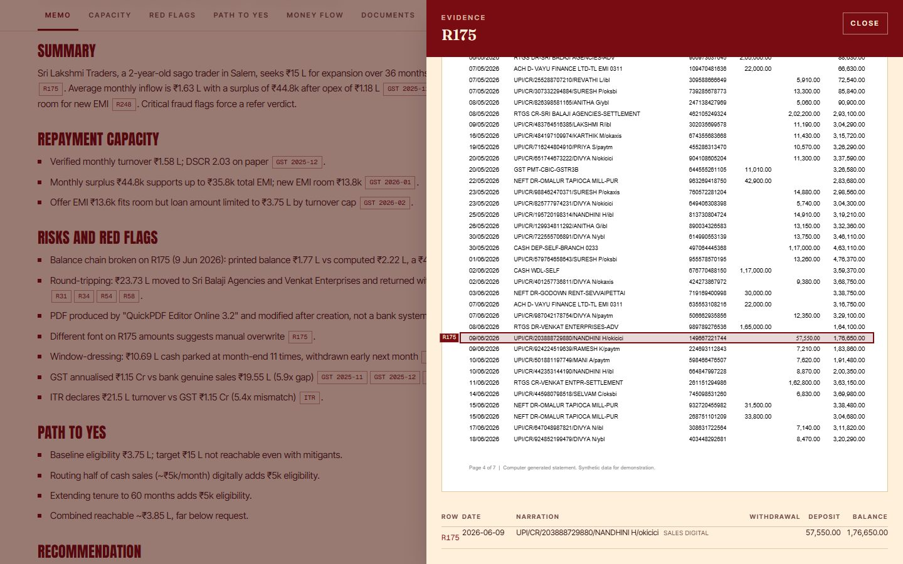
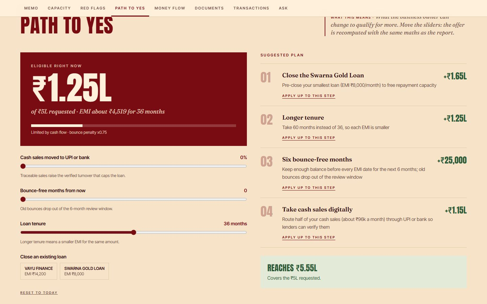
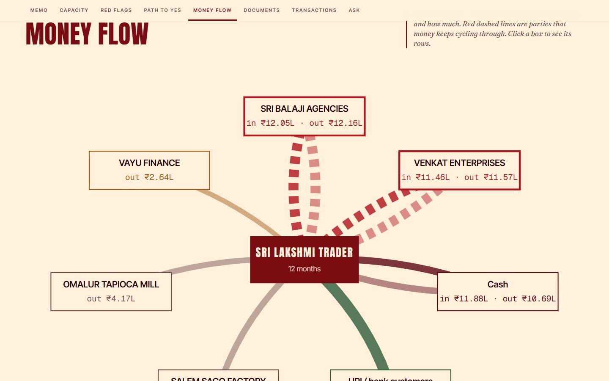
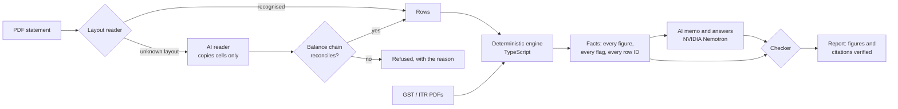
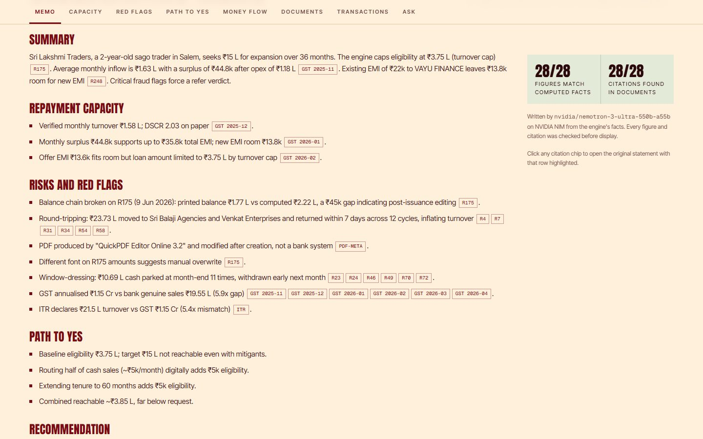
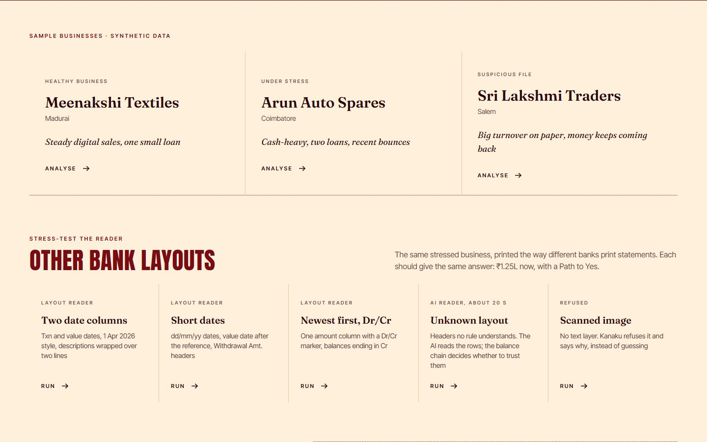

# Kanaku

**An AI credit underwriter for Indian small businesses. Every rupee proven, every "no" turned into a path to yes.**

*Kanaku* comes from the Tamil *kanakku*: accounts, the reckoning of money.

Built solo for **Arthaton 2026**.


> **Live demo:** _link added after deployment_  ·  **Demo video:** _link added after upload_
>
> On the analyze page, the three sample businesses run in one click. No upload or sign-up is needed.

---

## The problem

India has over 6 crore MSMEs, and their credit gap is estimated at ₹20–25 lakh crore. Most small businesses are thin-file: no audited accounts, so lenders underwrite them from bank statements. Today that means one of two things:

1. **A credit officer reads hundreds of rows by hand.** It is slow, inconsistent, and easy to fool. Edited PDFs, money cycled through friends' accounts and month-end cash parking all get through.
2. **A rule engine says "rejected" and nothing else.** The owner never learns what would have made the loan work.

Pasting a statement into a chatbot doesn't solve this. A chatbot does arithmetic in its head, gives different numbers on a second run, can't prove where a figure came from, and won't notice that one row was typed over.

## What Kanaku does

A loan officer, or the business owner, uploads a **bank statement**, and optionally **GST returns** and an **ITR**. In under a minute Kanaku returns an underwriting report:

| | |
|---|---|
| **Decision** | Approve, approve a reduced amount, decline, or refer to fraud review, with the binding constraint named. |
| **Repayment capacity** | Real sales, operating costs, existing EMIs found in the statement, the room left for a new EMI, and the turnover cap. |
| **Red flags** | Twelve checks, ranked by severity. A critical finding stops the loan regardless of capacity. |
| **Path to Yes** | The exact changes that would unlock more credit, with live sliders. |
| **Money-flow map** | Who pays the business and whom it pays. Round-tripping shows up as red dashed loops. |
| **Three-document cross-check** | Bank vs GST vs ITR. Three filings that describe different businesses are a warning sign. |
| **AI memo and Q&A** | A plain-English memo and a question box. Every figure and citation is checked before it is shown. |

**Every number is clickable.** Each figure and each `R175` chip opens the original PDF page with that row highlighted.



## What makes it different

### 1. Path to Yes
Other tools stop at "rejected". Kanaku shows the owner the plan:

> **Arun Auto Spares** asked for ₹5L and qualifies for **₹1.25L** today. Close the small gold loan (+₹1.65L), take 60 months instead of 36 (+₹1.25L), stay bounce-free for six months (+₹25k) and move half the cash sales to UPI (+₹1.15L). **That reaches ₹5.55L.**

The offer is recalculated as the sliders move, using the same deterministic maths as the report. The AI is not involved in any of these numbers.



### 2. Tamper detection
Kanaku re-adds every row: previous balance + credit − debit must equal the printed balance. An edited amount breaks that chain on exactly one row. Kanaku also checks:
- the **font** of every amount (a typed-over number usually uses a different font);
- the **PDF metadata** (a bank's core system did not produce a file saved by "QuickPDF Editor Online").

For Sri Lakshmi Traders, Kanaku finds row **R175**, where a ₹57,550 credit was inflated by **₹45,000**. The proof drawer opens that page with the row highlighted.

### 3. Fraud patterns a person misses
- **Round-tripping:** ₹50k or more sent to a party and returned within 7 days, within 5% of the amount. Sri Lakshmi Traders did this 12 times with two parties, for ₹23.73L.
- **Window dressing:** large cash deposits in the last 3 days of a month, withdrawn in the first 5 days of the next.
- **GST vs bank vs ITR:** GST declared ₹1.15 Cr a year, while ₹19.55L of genuine sales reached the bank (5.9×) and the ITR says ₹21.5L.



## Why you can trust it: the AI never does the maths



| Step | Who does it | How it is kept honest |
|---|---|---|
| Reading the statement | A layout-aware parser. The AI reads only layouts the parser doesn't recognise. | Every parse must reconcile against the running balance, or it is rejected. When the AI reads a file, it only copies cells; whether an amount is money in or out comes from the balance arithmetic. |
| Labelling transactions | Rules first. The AI labels only narrations the rules can't place. | Labels feed the engine; they never change a printed amount. |
| Every number in the report | Deterministic TypeScript engine ([`src/lib/engine`](src/lib/engine)) | Unit-tested; the policy constants are in one file. |
| Memo and answers | NVIDIA Nemotron 3 Ultra on NIM | Every rupee figure must match a computed fact (exact to ₹1, or within rounding for lakh and crore figures). Every citation must be a real row, GST month, ITR or PDF metadata. The result is shown on the memo, for example *28/28 figures match, 28/28 citations found*. Any failure is shown struck through. |

Each report also states how it was produced: which reader was used, how many rows reconcile, how many narrations the AI labelled, and who wrote the memo.



## Works on more than its own sample files

The analyze page includes the same business printed in **other bank layouts**, so the reader can be tested live:

| Layout | What is different | Read by |
|---|---|---|
| Two date columns | Txn and value dates, `1 Apr 2026` dates, descriptions wrapped over two lines | Layout reader |
| Short dates | `dd/mm/yy`, value date after the reference, "Withdrawal Amt." headers | Layout reader |
| Newest first, Dr/Cr | A single amount column with a Dr/Cr marker, balances ending in "Cr" | Layout reader |
| Unknown layout | Headers no rule understands | AI reader, balance-checked |
| Scanned image | No text layer | Refused, with the reason |

All four readable layouts produce the same 363 rows and the same decision as the original. Password-protected PDFs open with a password field; the password is used only to open the file and is never stored.



## Underwriting policy

Every assumption is in [`src/lib/engine/policy.ts`](src/lib/engine/policy.ts) and is shown in the UI.

| Rule | Value |
|---|---|
| Minimum DSCR on monthly surplus (sales minus operating costs) | 1.25 |
| Loan cap | 20% of verified annual turnover (Nayak Committee heuristic) |
| Cash counted toward the turnover cap | 50% (cash cannot be traced to customers) |
| Assumed rate | 18% a year, unsecured MSME term loan |
| EMI bounces in the last 6 months | 0 → ×1, 1 → ×0.9, 2–3 → ×0.75, 4+ → ×0.5 |
| Round trip | ≥ ₹50k, back within 7 days, within 5% |
| Window dressing | ≥ ₹50k, last 3 days of a month, reversed in the first 5 days, within 10% |

## The three sample businesses (synthetic)

| Business | Scenario | Kanaku's answer |
|---|---|---|
| **Meenakshi Textiles**, Madurai | Healthy: steady digital sales, one small loan | **Approve ₹5L** (capacity ₹10.2L) |
| **Arun Auto Spares**, Coimbatore | Stressed: cash-heavy, two loans, 3 recent EMI bounces | **₹1.25L now**, Path to Yes to ₹5.55L |
| **Sri Lakshmi Traders**, Salem | Fraud: edited row, 12 round trips, month-end cash, GST 5.9× bank | **Refer to fraud review**, 7 red flags |

All data is generated by [`scripts/generate-samples.ts`](scripts/generate-samples.ts). No real person's bank statement, PAN or account number is used anywhere.

## Run it locally

Requirements: Node 20 or newer.

```bash
git clone https://github.com/mithileshofficial06/kanaku.git
cd kanaku
npm install
cp .env.example .env.local    # then add your NVIDIA NIM key (free at build.nvidia.com)
npm run dev                   # http://localhost:3000
```

Without a key everything still works: the memo falls back to a template built from the same facts, and only the AI reader for unknown layouts is unavailable.

| Command | What it does |
|---|---|
| `npm test` | 21 tests: exact parsing of every sample and every bank layout, engine outcomes, verifier |
| `npm run gen:samples` | Regenerate the three sample businesses (PDFs plus ground truth) |
| `npm run gen:formats` | Regenerate the other-bank layouts and the scanned file |
| `npx tsx --env-file=.env.local scripts/bench-memo.ts` | Live memo timing and verification against NIM |

### Environment

```
NIM_API_KEY=nvapi-...
NIM_BASE_URL=https://integrate.api.nvidia.com/v1
NIM_MODEL_SMART=nvidia/nemotron-3-ultra-550b-a55b      # memo and answers
NIM_MODEL_FAST=nvidia/nemotron-3.5-lightning-30b-a3b   # narration labels, AI reader
```

## Stack

Next.js 15 (App Router) · React 19 · TypeScript · Tailwind CSS 4 · Motion · pdf.js (parsing and the proof viewer) · pdf-lib (synthetic documents) · OpenAI-compatible SDK against NVIDIA NIM · Vitest

```
src/lib/parse/      PDF reading, layout-aware statement parser, GST and ITR parsers
src/lib/engine/     categorise, eligibility and Path to Yes, fraud checks, report
src/lib/llm.ts      NIM client, AI reader, labelling, memo, answers, verifier
src/lib/pipeline.ts documents in, report out
src/app/api/        analyze, memo, ask, status
src/components/     landing page, report, proof drawer, feature pages
```

## Path to production

- **Account Aggregator.** Fetch statements directly from the bank through India's RBI-regulated AA network. That removes edited PDFs at the source; tamper detection then guards the PDF path that most lenders still accept.
- **On-premise model.** Nemotron is an open model, so a lender can host it inside its own network and statements never leave the bank.
- **More layouts and OCR.** Add bank-specific layouts as they come up. Scanned statements would need OCR plus the same balance-chain gate before any row is trusted.
- **Bureau data.** Combine with CIBIL or CRIF for repayment history beyond the one account.

## Limits, stated plainly

- Kanaku supports a credit decision; it is not a lending decision. A credit officer makes the call.
- The policy constants are reasonable defaults, not any lender's actual credit policy.
- Every sample document is synthetic. Don't upload real customer data to a public demo.

## AI tools used

| Tool | Used for |
|---|---|
| **Claude Code** (Anthropic, Claude Opus 5.5) | Pair-programming the whole build: architecture, code, tests, synthetic data generation and UI. |
| **NVIDIA NIM: Nemotron 3 Ultra** (`nvidia/nemotron-3-ultra-550b-a55b`) | In the app: writes the underwriting memo and answers questions. |
| **NVIDIA NIM: Nemotron 3.5 Lightning** (`nvidia/nemotron-3.5-lightning-30b-a3b`) | In the app: labels unclear narrations and reads unrecognised statement layouts. |

All business logic, parsing and arithmetic is deterministic code in this repository. No AI computes any number in the report.

---

Built for Arthaton 2026.
