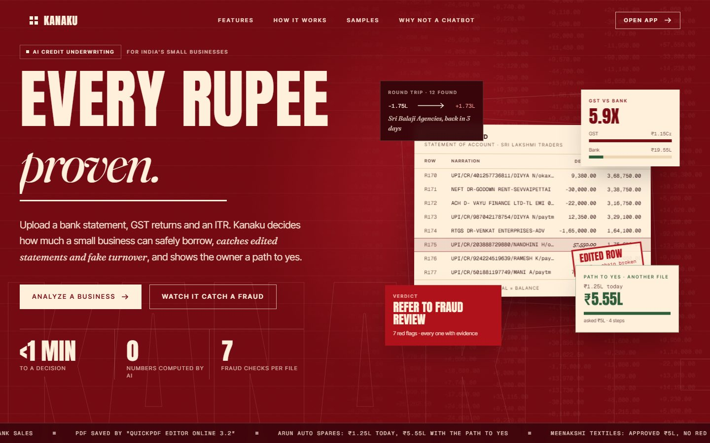
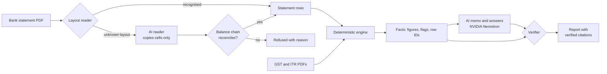

<div align="center">


# Kanaku

### AI credit underwriting for India's small businesses

**Every rupee proven. Every "no" turned into a path to yes.**

<p>
  
  
  
  
  
  
  
</p>

<p>
  <a href="#live-demo"><b>Live demo</b></a> &nbsp;·&nbsp;
  <a href="#demo-video"><b>Demo video</b></a> &nbsp;·&nbsp;
  <a href="#quick-start"><b>Quick start</b></a> &nbsp;·&nbsp;
  <a href="#how-it-works"><b>How it works</b></a>
</p>



</div>

---

## Overview

India has over 6 crore MSMEs, and their credit gap is estimated at ₹20–25 lakh crore. Most of these businesses are thin-file: no audited accounts, so lenders underwrite them from **bank statements**. Today that happens in one of two ways:

- **Manual review.** A credit officer reads hundreds of rows. It is slow, inconsistent, and easy to fool with edited PDFs, money cycled through friends' accounts, or cash parked at month-end.
- **Rule engines.** They say "rejected" and stop. The owner never learns what would have made the loan work.

**Kanaku** reads a bank statement (plus optional GST returns and an ITR) and produces a complete underwriting report in under a minute: a decision, the repayment maths, ranked red flags, and a concrete plan to qualify for more. **Every number is computed by deterministic code, and every figure links back to its row on the original PDF.**

> Kanaku is decision support for a credit officer, not an automated lending decision. All data in this repository is synthetic.

---

## Features

<table>
  <tr>
    <td width="52" valign="top"></td>
    <td width="44%" valign="top"><b>Path to Yes</b><br /><sub>Instead of a flat rejection, the owner sees the exact changes that unlock the amount they asked for, with live what-if sliders.</sub></td>
    <td width="52" valign="top"></td>
    <td width="44%" valign="top"><b>Tamper detection</b><br /><sub>Re-adds every running balance, compares the fonts of every amount, and reads the PDF's metadata. One edited number gets caught.</sub></td>
  </tr>
  <tr>
    <td width="52" valign="top"></td>
    <td width="44%" valign="top"><b>Fraud patterns</b><br /><sub>Round-tripping through linked parties and month-end window dressing, detected and excluded from income.</sub></td>
    <td width="52" valign="top"></td>
    <td width="44%" valign="top"><b>Three-document check</b><br /><sub>Bank vs GST vs ITR. A business has one real turnover; Kanaku checks that all three filings agree.</sub></td>
  </tr>
  <tr>
    <td width="52" valign="top"></td>
    <td width="44%" valign="top"><b>Repayment capacity</b><br /><sub>Genuine sales, operating costs and existing EMIs found in the statement, turned into a safe new EMI, every step shown.</sub></td>
    <td width="52" valign="top"></td>
    <td width="44%" valign="top"><b>Money-flow map</b><br /><sub>Who pays the business and whom it pays. Money cycling through a party shows up as a red loop.</sub></td>
  </tr>
  <tr>
    <td width="52" valign="top"></td>
    <td width="44%" valign="top"><b>Proof for every number</b><br /><sub>The AI memo cites rows, and code verifies every figure and citation before display. Click any citation to see the original page.</sub></td>
    <td width="52" valign="top"></td>
    <td width="44%" valign="top"><b>Reads any bank's layout</b><br /><sub>A layout-aware parser with an AI fallback, both gated by the balance chain. Password-protected PDFs are supported; scans are refused with the reason.</sub></td>
  </tr>
</table>

<br />

<div align="center">
  
  <sub><b>The proof drawer.</b> Clicking a citation opens the original PDF page with the row highlighted. Here, row R175 has had ₹45,000 added to it.</sub>
</div>

---

## How it works



### The AI never does the maths

| Stage | Performed by | Safeguard |
|---|---|---|
| **Reading** | Layout-aware parser. The AI reads only layouts the parser can't recognise. | Every parse must reconcile against the running balance. The AI only copies cells; balance arithmetic decides whether each amount is money in or out. |
| **Labelling** | Rules first. The AI labels only narrations the rules can't place. | Labels never change a printed amount. |
| **Calculation** | Deterministic TypeScript engine | Unit-tested; every assumption is in one policy file. |
| **Explanation** | NVIDIA Nemotron 3 Ultra | Every rupee figure must match a computed fact, and every citation must exist. Results are shown on the memo (for example *28/28 figures, 28/28 citations*). |

Each report also shows how it was produced: which reader was used, how many rows reconcile, what the AI labelled, and who wrote the memo.

---

## See it in action

The analyze page includes three synthetic businesses that run with one click:

| Business | Scenario | Kanaku's decision |
|---|---|---|
| **Meenakshi Textiles**, Madurai | Healthy: steady digital sales, one small loan | **Approve ₹5L** (capacity ₹10.2L) |
| **Arun Auto Spares**, Coimbatore | Stressed: cash-heavy, two loans, 3 recent EMI bounces | **₹1.25L now**, with a Path to Yes to ₹5.55L |
| **Sri Lakshmi Traders**, Salem | Fraud: edited row, 12 round trips, GST 5.9× bank | **Refer to fraud review**, 7 evidence-backed red flags |

<div align="center">
  
  <sub><b>Path to Yes.</b> Arun Auto Spares qualifies for ₹1.25L today. Closing the small gold loan, taking a longer tenure, six bounce-free months and moving half the cash sales to UPI reach ₹5.55L.</sub>
</div>

<br />

It also includes the same business printed in **four other bank layouts** (different date styles, a single amount column with a Dr/Cr marker, newest-first order, an unrecognised layout) and a scanned image. Every readable layout produces the same 363 rows and the same decision; the scan is refused with the reason.

---

## Quick start

**Requirements:** Node.js 20+ and a free NVIDIA NIM API key from [build.nvidia.com](https://build.nvidia.com). The app runs without a key, using template memos.

```bash
git clone https://github.com/mithileshofficial06/kanaku.git
cd kanaku
npm install
cp .env.example .env.local      # add your NVIDIA NIM key
npm run dev                     # http://localhost:3000
```

### Configuration

| Variable | Purpose | Default |
|---|---|---|
| `NIM_API_KEY` | NVIDIA NIM key (`nvapi-...`) | none (template mode) |
| `NIM_BASE_URL` | OpenAI-compatible endpoint | `https://integrate.api.nvidia.com/v1` |
| `NIM_MODEL_SMART` | Memo, answers and narration labels | `nvidia/nemotron-3-ultra-550b-a55b` |
| `NIM_MODEL_FAST` | The AI reader for unknown layouts | `nvidia/nemotron-3.5-lightning-30b-a3b` |

### Scripts

| Command | Description |
|---|---|
| `npm run dev` | Start the development server |
| `npm run build && npm start` | Production build and server |
| `npm test` | Run the 21 tests (exact parsing of every sample and layout, engine outcomes, verifier) |
| `npm run gen:samples` | Regenerate the three sample businesses |
| `npm run gen:formats` | Regenerate the alternative bank layouts and the scanned file |

---

## Underwriting policy

Every assumption lives in [`src/lib/engine/policy.ts`](src/lib/engine/policy.ts) and is shown in the UI.

| Rule | Value |
|---|---|
| Minimum DSCR on monthly surplus | 1.25 |
| Loan cap | 20% of verified annual turnover (Nayak Committee heuristic) |
| Cash counted toward the cap | 50%, because cash cannot be traced to customers |
| Assumed interest rate | 18% a year, unsecured MSME term loan |
| EMI bounces in the last 6 months | 0 → ×1 · 1 → ×0.9 · 2–3 → ×0.75 · 4+ → ×0.5 |
| Round trip | ≥ ₹50k, returned within 7 days, within 5% |
| Window dressing | ≥ ₹50k in the last 3 days of a month, reversed within the first 5 |

---

## Project structure

```
src/
├── app/
│   ├── api/               analyze · memo · ask · status
│   ├── analyze/           the underwriting workspace
│   └── features/[slug]/   one explainer page per feature
├── components/
│   ├── report/            report view, proof drawer, Path to Yes, charts
│   └── motion.tsx         animation primitives
└── lib/
    ├── parse/             PDF reading, layout-aware statement parser
    ├── engine/            categorise, eligibility, Path to Yes, fraud checks
    ├── llm.ts             NIM client, AI reader, memo, answers, verifier
    └── pipeline.ts        documents in, report out
scripts/                   synthetic data generators, live AI benchmarks
```

**Stack:** Next.js 15 · React 19 · TypeScript · Tailwind CSS 4 · Motion · pdf.js · pdf-lib · NVIDIA NIM (OpenAI-compatible API) · Vitest

---

## Roadmap

- **Account Aggregator integration.** Fetch statements directly from banks through India's RBI-regulated AA framework, which removes edited PDFs at the source.
- **On-premise deployment.** Nemotron is an open model, so a lender can host it inside its own network and statements never leave the institution.
- **OCR for scanned statements.** Behind the same balance-chain gate, so no unverified row is ever used.
- **Credit bureau data.** Combine with bureau reports for repayment history beyond a single account.

## Limitations

- Kanaku supports a credit officer's decision; it does not make the lending decision itself.
- The policy values are reasonable defaults, not any lender's actual credit policy.
- Every sample document is synthetic. Do not upload real customer data to a public demo.

---

## Live demo

_Link to be added after deployment._

## Demo video

_Link to be added after upload._

## AI tools used

| Tool | Role |
|---|---|
| **Claude Code** (Anthropic, Claude Opus 5.5) | Development partner for the whole build: architecture, code, tests, synthetic data and UI |
| **NVIDIA NIM: Nemotron 3 Ultra** | In the app: writes the underwriting memo, answers questions, and labels narrations the rules cannot place |
| **NVIDIA NIM: Nemotron 3.5 Lightning** | In the app: reads unrecognised statement layouts |

All parsing, business logic and arithmetic is deterministic code in this repository. No AI computes any number in a report.

<div align="center">
<br />
<sub>Built solo for <b>Arthaton 2026</b> · <i>Kanaku</i>, from the Tamil <i>kanakku</i>: accounts, the reckoning of money</sub>
</div>
